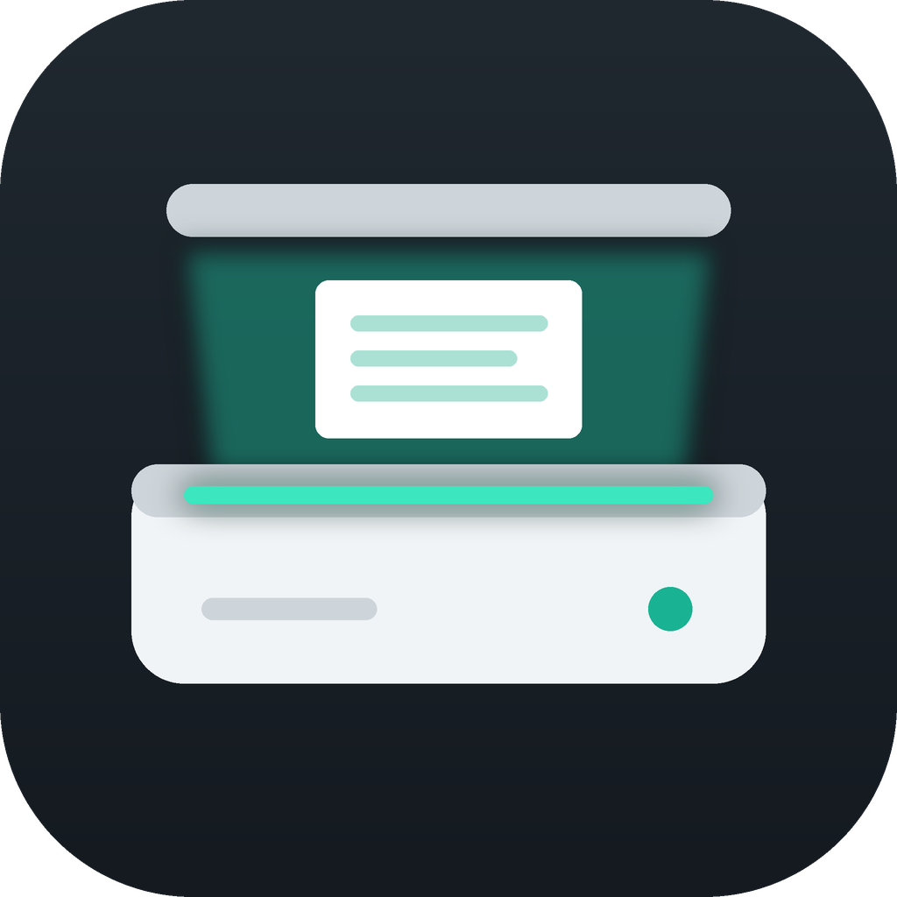

# DocScan

  

<b>Digitalize. Organize. Compartilhe.</b>

O DocScan é um app Android de **escaneamento de documentos** e **leitura de PDF**, no estilo do CamScanner. Ele foi feito em Flutter. **Tudo fica no próprio celular**: o app não tem conta nem servidor e não envia nada para a internet.

Versão atual: **2.0.0**

---

## Funcionalidades

### Digitalizar
- **Documento**: scanner automático (Google ML Kit) que detecta as bordas sozinho. Se ele falhar no aparelho, entra o modo manual.
- **Modo livro**: digitaliza páginas de livros e cadernos.
- **Cartão ID**: captura frente e verso do documento (scanner, câmera ou galeria). Lê automaticamente os dados da faixa MRZ (passaporte, RG novo, Cartão de Cidadão) e campos como CPF, nome e datas.
- **Texto (OCR)**: extrai o texto de uma foto, que pode ser copiado, compartilhado ou salvo em PDF.
- **Recriar página**: lê o texto da foto, deixa corrigir linha por linha e monta um PDF novo e limpo.
- **Leitor QR**: lê QR codes e códigos de barras.

### Editar imagem
- Recorte pelos 4 cantos com correção de perspectiva
- Filtros: Original, Mágico, Desamassar, P&B, **Restaurar**, Cinza e Realçar
- Rotação

#### Filtro Restaurar
Recupera páginas em mau estado (papel amarelado, manchas, sombras, texto desbotado). Primeiro normaliza o fundo, depois faz uma binarização adaptativa de Sauvola com bordas suaves, para as letras finas não quebrarem, e no fim remove pontinhos isolados. O código está em `image_ops.dart` (`_restore`); o valor `k` controla a força: mais alto limpa mais, mais baixo preserva texto fraco.

### Criar e importar
- **Criar PDF**: título, texto e fotos, com tamanho e orientação da página à escolha.
- **Importar PDF** do celular.
- **Fotos para PDF**: junta várias fotos num único PDF.

### Converter
- PDF para imagens
- PDF para uma imagem longa
- PDF para texto
- PDF para Word

### Editar PDF
- Adicionar páginas
- Organizar páginas (segure e arraste), girar, excluir e extrair
- Dividir e mesclar PDFs
- **Assinar** com a assinatura desenhada com o dedo
- Marca d'água e carimbo de data

### Utilitários
- Comprimir PDF
- Proteger com senha e remover senha
- Imprimir

### Leitor de PDF
- Respeita retrato e paisagem de cada página, ajusta à largura da tela e tem zoom com pinça.
- **Abre PDFs de outros apps**: o DocScan aparece na opção "Abrir com" e no "Compartilhar" do Android.

### Aba "Eu"
- Tema automático, claro ou escuro
- Liga/desliga o scanner automático
- **Fazer backup**: gera um `.zip` com todos os documentos, que pode ir para o Google Drive, o e-mail ou uma pasta do celular.
- **Restaurar backup**: traz de volta os documentos de um `.zip`, sem duplicar os que já existem.
- Limpar miniaturas para liberar espaço
- Vídeo tutorial "Como usar" (30 segundos)

---

## Como gerar o APK

O APK é compilado automaticamente pelo **GitHub Actions**, sem precisar de computador:

1. Envie as alterações para a branch `main`, ou abra **Actions → Build Android APK → Run workflow**.
2. Espere a compilação terminar (cerca de 6 a 10 minutos).
3. Abra a execução concluída e baixe o artefato **`docscan-apk`**. Ele vem em `.zip` e tem o `app-release.apk` dentro.
4. Instale no celular. Se o Android pedir, permita a instalação de fontes desconhecidas.

### O que o workflow faz
Os arquivos `.dart` ficam todos na raiz do repositório. O workflow (`.github/workflows/build.yml`) monta o projeto Flutter na hora:

- move `main.dart` para `lib/`, `doc_store.dart`, `image_ops.dart` e `pdf_tools.dart` para `lib/services/`, e o resto para `lib/screens/`;
- usa `logo_docscan.png` como logo e ícone do app;
- copia a fonte DejaVu Sans, que tem acentos, para os PDFs criados no app;
- gera as pastas `android/` e `ios/` com `flutter create`;
- força `compileSdk 36` nos plugins;
- registra o DocScan para abrir PDFs vindos de outros apps (`AndroidManifest.xml` + `MainActivity.kt`);
- define o nome do app como **DocScan** e gera os ícones;
- compila com `flutter build apk --release`.

---

## Estrutura dos arquivos

| Arquivo | O que faz |
|---|---|
| `main.dart` | Ponto de entrada do app |
| `splash_screen.dart` | Tela de abertura (`kAppVersion`) |
| `home_screen.dart` | Estrutura com as 4 abas |
| `tab_home.dart` | Início: atalhos e documentos recentes |
| `tab_docs.dart` | Lista de documentos |
| `tab_tools.dart` | Aba Ferramentas |
| `tab_me.dart` | Aba Eu: tema, backup, privacidade, versão |
| `tool_actions.dart` | Ações de cada ferramenta |
| `editor_screen.dart` | Recorte, perspectiva, filtros e giro |
| `create_pdf_screen.dart` | Criar PDF |
| `page_manager.dart` | Organizar páginas |
| `signature_screen.dart` | Desenhar assinatura |
| `place_screen.dart` | Posicionar carimbo, assinatura e marca d'água (arrastar, tamanho, transparência) |
| `recreate_screen.dart` | Recriar página via OCR |
| `id_reader.dart` | Leitura de documentos de identidade (MRZ, CPF...) |
| `text_screen.dart` | Exibir texto extraído |
| `viewer_screen.dart` | Leitor de PDF |
| `doc_picker.dart` | Escolher um ou vários PDFs |
| `doc_widgets.dart` | Linha de documento (miniatura, nome, data, tamanho) |
| `tutorial_screen.dart` | Vídeo "Como usar" |
| `common.dart` | Tema e componentes comuns |
| `doc_store.dart` | Armazenamento dos documentos e backup |
| `image_ops.dart` | Operações de imagem (em isolates) |
| `pdf_tools.dart` | Operações em PDF (em isolates) |
| `assets/video/` | Vídeo tutorial e capa |

### Principais bibliotecas
`cunning_document_scanner` (scanner), `google_mlkit_text_recognition` (OCR), `google_mlkit_barcode_scanning` (QR), `pdf` e `printing` (gerar e imprimir), `pdfrx` (leitor), `syncfusion_flutter_pdf` (senha, mesclar, dividir), `image` (filtros), `archive` (backup .zip).

---

## Lançar uma nova versão
Atualize o número em dois lugares, sempre juntos:
- `version:` no `pubspec.yaml` (ex.: `2.1.0+3`)
- `kAppVersion` no `splash_screen.dart` (ex.: `'2.1.0'`)

Depois é só enviar para a `main`, e o GitHub Actions gera o novo APK.

---

## Privacidade
Os documentos ficam apenas no armazenamento do app no celular. O DocScan não tem conta, não tem servidor e não envia dados para a internet. Para guardar uma cópia ou passar para outro celular, use **Eu → Fazer backup**.

---

## Autor
**Luiz Alberto Cardoso** · tecsattv@gmail.com
